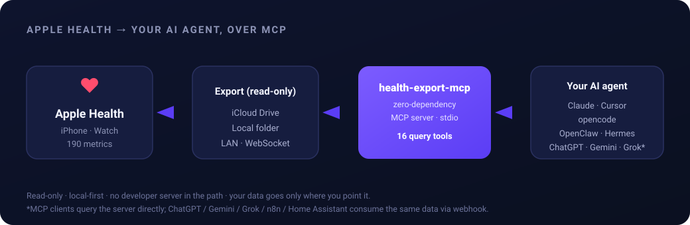
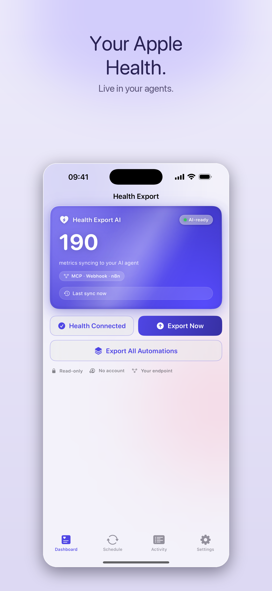
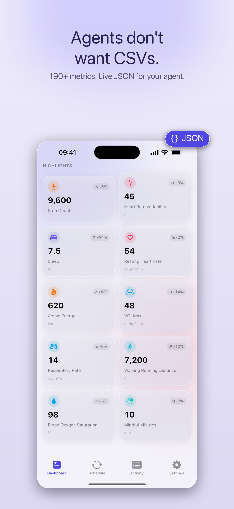
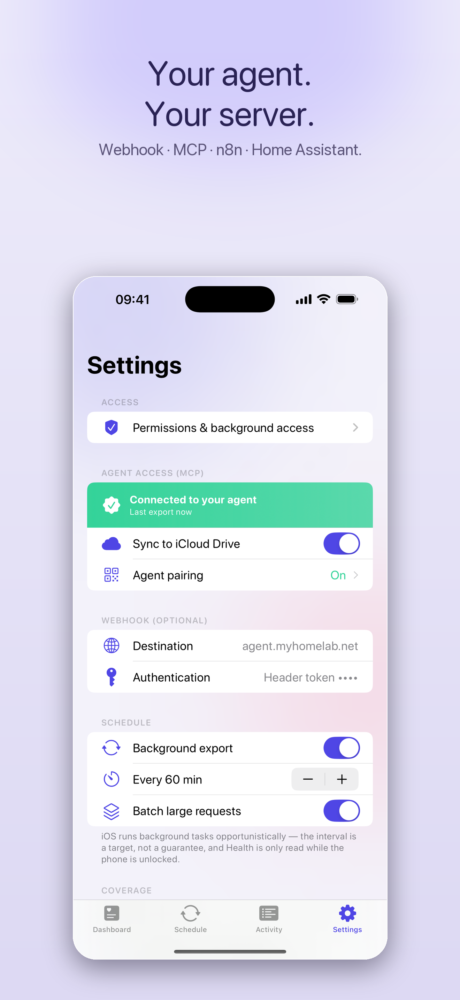

# health-export-mcp

**An MCP server for your own Apple Health data.** 194 metrics, 18 tools (16 read-only, plus two that log events to their own file) and 22 prompts over local stdio, with zero dependencies, no account and no server of ours in the path. Your agent gets JSON with units, date ranges and coverage, and answers from your numbers.

<p align="center">
  <a href="https://www.npmjs.com/package/health-export-mcp"></a>
  <a href="https://github.com/PhilipAD/health-export-mcp/actions/workflows/ci.yml"></a>
  <a href="SECURITY.md"></a>
  
  <a href="LICENSE"></a>
  <a href="https://glama.ai/mcp/servers/PhilipAD/health-export-mcp"></a>
</p>

Docs and per-client config: **[healthexport.dev/mcp](https://www.healthexport.dev/mcp/)** · agents can run the setup from **[SKILL.md](https://www.healthexport.dev/SKILL.md)** · privacy: the server reads a local file and makes no network requests, so your health data never reaches us or a cloud AI through it.

## Install: one command

```bash
claude mcp add health-export -- npx -y health-export-mcp
```

On a Mac that is the whole install: since 1.7.3 the server finds the MetricBridge app's iCloud Drive folder by itself. On Windows or Linux, or for an export in another folder, add `--env "HEALTH_DATA_DIR=/path/to/folder"` before the `--`. Needs Node.js 18 or later. **Claude Desktop:** open [`health-export.mcpb`](https://github.com/PhilipAD/health-export-mcp/releases/latest/download/health-export.mcpb) instead (no JSON, no Node on your PATH). Cursor, VS Code, opencode, OpenClaw, Hermes: [AGENTS.md](AGENTS.md).

Then ask *"Use health-export: how did my HRV this week compare with last week?"* The agent calls `get_trends` and gets numbers that carry their own provenance: unit, exact date ranges, whether each window was complete, and how much history the export holds. This is the real output on 1.7.3 (from the built-in `--demo` dataset, which is synthetic so it can be published; a real export answers with the same fields and without the watermark):

```json
[SYNTHETIC DEMO DATA] {"metric":"heart_rate_variability","unit":"ms","window":7,"recent":50.859,"prior":51.306,
 "change":-0.447,"changePercent":-0.871,"direction":"flat","recentRange":{"from":"2026-08-12","to":"2026-08-18"},
 "recentDays":7,"priorDays":7,"windowSatisfied":true,"coverage":{"firstDate":"2025-07-15","lastDate":"2026-08-18","days":400}}
```

**No iPhone yet?** `claude mcp add health-export-demo -- npx -y health-export-mcp --demo` serves that watermarked synthetic dataset, so you can try every tool in 30 seconds before installing anything on a phone.

## Use your real data (about 5 minutes the first time, needs an iPhone)

1. **Export.** Install [MetricBridge](https://apps.apple.com/app/apple-store/id6784185201?pt=129083290&ct=githubreadme&mt=8&ppid=2c28f88a-d94f-48f9-8e6a-74a8d89ce66e) on the iPhone, allow Health read access and tap **Export now**. It writes `.health-cache.json` to iCloud Drive (or a folder, or your LAN). The app has a 7-day free trial, then one purchase ($24.99), no subscription. This server is MIT and free.
2. **Connect.** The one command above (Claude Code), the `.mcpb` (Claude Desktop), or the block for your client in [AGENTS.md](AGENTS.md).
3. **Check it arrived.** `npx -y health-export-mcp --doctor` prints the folder it chose and why, each file's age, and freshness. iCloud can take a few minutes to bring a new export to the Mac.

<p align="center">
  
</p>

---

## What is health-export-mcp?

It's an MCP server that turns your Apple Health export into tools your AI agent can query in natural language: HRV, sleep, resting heart rate, steps, workouts, VO₂ max and 180+ more.

- **Who it's for:** anyone who wants their AI to reason over their *real* health data instead of a stale CSV.
- **What it isn't:** a cloud service. There's no developer server in the path, your data goes only where *you* point it.
- **Setup:** point the server at your exported data and add it to your AI client.
- **Where the data comes from:** the [MetricBridge](https://www.healthexport.dev) iOS app (formerly Health Export AI), [available on the App Store](https://apps.apple.com/app/apple-store/id6784185201?pt=129083290&ct=githubreadme&mt=8&ppid=2c28f88a-d94f-48f9-8e6a-74a8d89ce66e), writes the export this server reads. The server still reports itself as `health-export-ai` in `serverInfo`, and the npm package and repository names are unchanged.

> **Just exported and the Mac has not seen it yet?** iCloud can take a few minutes to sync the
> file across, so a check 60 seconds after tapping Run in the app can still show the old
> timestamp. `get_mcp_status` reports `lastDataDate` and the intraday `lastWrite`, which is the
> quickest way to tell "still syncing" from "never arrived".

> **Try it with no iPhone needed:** `npx -y health-export-mcp --demo` (or `node server.mjs --demo` in a clone) serves a deterministic synthetic dataset (400 days, workouts, events, sleep sessions) with every answer watermarked as synthetic. Or run `npm test` to write a sample cache and exercise every tool.

---

## Connect Apple Health to your AI agent: quickstart

### 1. Get your Apple Health data flowing

The companion iOS app **[MetricBridge](https://www.healthexport.dev)** exports your Apple Health data, read-only, automatic, private. For this MCP server, export to a destination it can read:

<p align="center"><a href="https://apps.apple.com/app/apple-store/id6784185201?pt=129083290&ct=githubreadme&mt=8&ppid=2c28f88a-d94f-48f9-8e6a-74a8d89ce66e"></a></p>

| Destination | Notes |
|---|---|
| **iCloud Drive** (default) | Your Mac reads the synced folder automatically |
| **Local folder** | Any folder that syncs to your Mac (Dropbox, Google Drive, OneDrive, …) |
| **LAN** (HTTP / WebSocket) | Direct push to the server, great over Tailscale |

> Using a non-MCP tool (ChatGPT, n8n, Home Assistant)? The app can also POST to a **webhook** those tools read directly, see [Works with](#works-with-claude-cursor-chatgpt-openclaw-hermes).

### 2. Add the server to your agent

**Fastest, one command (Claude Code):**

```bash
claude mcp add health-export -- npx -y health-export-mcp
# Windows, Linux, or an export outside iCloud Drive:
claude mcp add health-export --env "HEALTH_DATA_DIR=/path/to/folder" -- npx -y health-export-mcp
```

Everything before `--` is an option for `claude mcp add`, everything after it is the command that starts the server. On a Mac the server reads the app's iCloud Drive folder when `HEALTH_DATA_DIR` is unset (1.7.3+); if you set it to that folder by hand, double-quote it (the folder name contains a space) and use `$HOME`, because a quoted `~` is not expanded by the shell. Add `--scope user` to make the server available in every project (the default scope is the current project only). Check it with `claude mcp list`.

**Claude Desktop** (`~/Library/Application Support/Claude/claude_desktop_config.json`), and any client that takes an `mcpServers` block:

```json
{
  "mcpServers": {
    "health-export": {
      "command": "npx",
      "args": ["-y", "health-export-mcp"]
    }
  }
}
```

> Off a Mac, or for another folder, add `"env": { "HEALTH_DATA_DIR": "/path/to/folder" }` to the entry (a leading `~` is expanded by the server). `npx -y` fetches the published package at run time without an install prompt (npm verifies package integrity), so it runs anywhere with no clone or absolute path. The server expands a leading `~` in `HEALTH_DATA_DIR` itself, so the JSON form can keep it. Prefer to pin a vetted local checkout instead? Use `"command": "node", "args": ["REPLACE_WITH_ABSOLUTE_PATH/server.mjs"]`, get the path with `node -e "console.log(process.cwd()+'/server.mjs')"` inside the repo.
> Or skip JSON entirely, drag **`health-export.mcpb`** into **Claude Desktop → Settings → Extensions**.

**Auto-configure from a clone:**

```bash
git clone https://github.com/PhilipAD/health-export-mcp.git
cd health-export-mcp
node apply-mcp-config.mjs     # detects installed clients and writes the config for you
```

**Cursor / VS Code:** `node gen-deeplinks.mjs` prints one-click install links.
**opencode / OpenClaw / Hermes:** see **[AGENTS.md](AGENTS.md)** for the exact block, same shape, one per client.

### 3. Ask your agent

Restart the client and try:

> *"Use health-export: what's my average HRV this week vs last week?"*

---

## Works with Claude, Cursor, ChatGPT, OpenClaw, Hermes

| Client / Agent | Integration | How |
|---|---|---|
| **Claude Code** | Native MCP | `claude mcp add ... -- npx -y health-export-mcp` |
| **Claude Desktop** | Native MCP | `.mcpb` bundle, or `mcpServers` block |
| **Cursor** | Native MCP | One-click deeplink, or `~/.cursor/mcp.json` |
| **opencode** | Native MCP | `opencode.json` `mcp` block |
| **OpenClaw** | Native MCP | Add the server block to your MCP config |
| **Hermes** | Native MCP | Add the server block to your agent's MCP config |
| **VS Code** (Copilot / Continue) | Native MCP | One-click deeplink |
| **ChatGPT · Gemini · Grok** | Webhook* | Consume the app's webhook export |
| **n8n · Home Assistant** | Webhook* | Trigger automations on the exported JSON |

<sub>*MCP clients query this server directly over stdio. ChatGPT / Gemini / Grok / n8n / Home Assistant don't speak MCP, they consume the same Apple Health data via the iOS app's token-authenticated **webhook** export.</sub>

---

## The 18 MCP tools

Full reference with request/response examples: **[healthexport.dev/mcp](https://www.healthexport.dev/mcp/#tools)**.

| Tool | What it does |
|---|---|
| `get_mcp_status` | Health check: source, metric/workout counts, which context files exist, latest data date, and a `freshness` summary. **Call first.** |
| `get_freshness` | How current the export is: `stale` judged on the core files (daily cache, sleep sessions) against a stated threshold (26 h by default, `HEALTH_STALE_AFTER_HOURS`, or `maxAgeHours`), `age_hours`, `as_of`, `last_data_date`, per-file write times. `state: "stale_copy"` (with a `stale_copy` list) when the phone's `.health-manifest.json` or iCloud says this Mac holds an older copy of a core file than the phone wrote. Same rule as the `status --max-age` cron gate. |
| `list_metrics` | Every available metric with unit, day count, and date range. |
| `get_health_metrics` | Daily values for a metric (or all) over a date range + an aggregate (avg/sum/min/max/latest). Supports `filterDays` (restrict to days covered by logged events, with `negate`). Blood pressure at day granularity also lists the individual `readings` (`health-readings.json`). |
| `get_trends` | Recent N-day window vs the prior N days: change, % change, direction. Supports `excludeTravelDays`. |
| `compare_periods` | A metric across two arbitrary date periods (A vs B), or around a logged event via `anchor: {eventId, days}` (the event day excluded from both sides). |
| `get_structured_export` | Clean JSON for chosen metrics/range, paginated with a cursor. |
| `get_intraday` | The hour-by-hour window from the app's hourly automations (`health-intraday.json`, app 1.4+): yesterday and today, replaced each run, with each hour's `Min`/`Max` for discrete metrics when the app writes them. |
| `query_health_data` | Natural-language convenience: *"average HRV last month"* routed to structured results. |
| `list_events` | Logged context events (medication, habit, visit, life, shift, episode, travel) with type/tag/date filters, from the app and from `add_event`, each labelled `source: "app"` or `"agent"`. |
| `add_event` | Log an event the user states (a medication start, a trip) into `health-events-agent.json`, the one file this server writes. Idempotent by `clientEventId`. |
| `remove_event` | Remove an event logged with `add_event`. Events logged in the iOS app are edited there. |
| `get_profile` | Opted-in context fields (conditions, medications, goals, allergies, notes) plus `presentFields`. Absent fields were withheld, never "none". |
| `get_workouts` | Workouts by activity/date with pagination; includes heart rate, running dynamics, cycling power, intervals and `hasRoute` when exported. |
| `get_sleep_sessions` | Clustered sleep sessions attributed to the waking day; split nights returned as separate sessions, duplicate copies of one night collapsed (`collapsedDuplicates`). |
| `get_cycle_context` | Day-in-cycle and coarse phase derived from logged period starts. Never predictive. |
| `correlate_metrics` | Pearson correlation between two metrics with a 0..3 day lag. Association, not causation, always stated. |
| `resolve_metric` | Canonical name and unit for any spelling (`steps`, `StepCount`, `Body Weight`, `hrv`), unit variants with exact formulas, an optional `{value, unit}` conversion, and whether the export holds it. Ambiguous words come back with candidates, never guessed. The data tools accept the same aliases and report `resolvedFrom`. When the export carries per-source attribution (app builds that write `src`/`by` on daily points and a `health-sources.json`, cache schema minor 2), the answer adds a `sources` block naming the devices that fed the export, which one won each metric and the priority rules, and `sourceMerge` reports disagreement as visible; older exports report it as not available. |

**Coverage:** 194 Apple Health metrics across activity, heart, HRV, mobility, respiratory, body, sleep, hearing, and nutrition, plus workouts. Data answers carry honest `coverage` blocks, and single-metric answers list logged events inside the window as `segmentBoundaries` so an average across a medication start or life change cannot masquerade as one regime.

### Data files

The daily cache (`.health-cache.json`) and workouts cache are joined by optional context files, all optional: `health-events.json` (the logging surface), `health-profile.json` (opt-in context), `health-sessions.json` (sleep sessions), `health-cycles.json` (observed cycle starts), `health-days.json` (timezone change log), `health-readings.json` (individual blood pressure readings) and `.health-manifest.json` (what the phone last wrote, for the stale-copy check). The server reads all of them and writes only `health-events-agent.json` (events logged with `add_event`). An absent file is reported as `available:false` with a note, never as "no data". Formats: [docs/SCHEMA-CONTRACTS.md](docs/SCHEMA-CONTRACTS.md).

Two patterns worth knowing: [query a parent's Apple Health from your own AI](docs/caregiver-setup.md) (consent-first, the parent's phone is the authority) and [logging data into Apple Health via Shortcuts](docs/shortcuts-write-bridge.md) (the server never writes to Apple Health).

### MCP prompts

The server ships 22 prompts over `prompts/list` / `prompts/get`: daily brief, weekly review, doctor visit prep, what changed since my last visit, sleep quality and regularity, HRV trend, training and race week reviews, zone minutes, n-of-1 experiment, medication before/after, GLP-1 dose-step compare, sobriety milestone, shift block compare, travel-honest monthly review, cycle-aware trend read, caregiver check-in, glucose day summary, long-term activity narrative, data coverage audit, and a profile-aware context bootstrap. Every prompt leads with coverage honesty and never turns data into diagnosis.

### Demo mode

`node server.mjs --demo` (or `HEALTH_DEMO=1`) serves a deterministic synthetic dataset: ~15 metrics over 400 days, 30 workouts with intervals, 8 events, a profile, 60 sleep sessions, cycle starts and a timezone change, anchored to a fixed date with a seeded PRNG. Every answer carries `demo: true` and a `[SYNTHETIC DEMO DATA]` text prefix, so demo output can never pass for a real export.

### CLI

```bash
node server.mjs --doctor            # diagnostics: files, sizes, schema, freshness, pairing
node server.mjs status --max-age 24 # exit 0 if data is fresh, 1 if stale or a stale iCloud copy (cron gate)
node server.mjs receive             # standalone LAN receiver (binds 127.0.0.1 by default)
node server.mjs --help
```

---

## Example AI queries

```text
"What has my resting heart rate done over the last 30 days?"
"Compare my deep sleep this week vs last week."
"Is my VO₂ max trending up or down this quarter?"
"Give me a clean JSON export of HRV, RHR and sleep for the last 14 days."
"Correlate my step count with my sleep duration this month."
```

---

## Use cases

- **AI health coach:** let an agent reason over your real HRV, resting heart rate, and sleep to suggest when to push and when to recover, grounded in your actual numbers instead of generic advice.
- **Training-load analysis:** pull workouts, VO₂ max, and heart-rate trends so your agent can flag overreaching, plot fitness progression, and pace a training block.
- **Sleep correlations:** have your agent correlate deep-sleep duration against steps, caffeine, late workouts, or screen time to see what tends to go with your better nights (associations, not causes).
- **Quantified-self dashboards:** feed clean JSON for any metric set and date range straight into a notebook, spreadsheet, or LLM-built dashboard for your own self-tracking.
- **Personal research & experiments:** run n-of-1 experiments (supplement, routine, or protocol changes) and let an agent compare before/after periods across 194 metrics to see what changed.

---

## Building a wellness or coaching product?

This server reads a file the MetricBridge iOS app writes **on the user's own device**, with no central
health-data processor in the path. The same app can POST signed JSON (Standard Webhooks v1, published
JSON Schemas) straight to **your** endpoint, so your users bring their own Apple Health to your product
without an SDK in your app and without any vendor server holding the data. The offer, flat pricing and
boundaries: [healthexport.dev/platforms](https://www.healthexport.dev/platforms/). The integration guide
and the zero-dependency conformance kit: [healthexport.dev/docs/platforms](https://www.healthexport.dev/docs/platforms/).
Wellness-scoped and end-user-directed; no clinical or HIPAA work.

---

## The app that feeds it

<p align="center">
  
  &nbsp;&nbsp;
  
  &nbsp;&nbsp;
  
</p>

<p align="center"><sub><a href="https://www.healthexport.dev">MetricBridge</a> exports your Apple Health to your agent, automatically.</sub></p>

<p align="center"><a href="https://apps.apple.com/app/apple-store/id6784185201?pt=129083290&ct=githubreadme&mt=8&ppid=2c28f88a-d94f-48f9-8e6a-74a8d89ce66e"><b>Download on the App Store →</b></a></p>

---

## Privacy & security

The one non-health thing the server reads from the export is `_meta.license`, a marker the app writes
with exactly two shapes: `{"state": "trial", "daysRemaining": N}` or `{"state": "unlocked"}`. A fresh
export from a trial adds one sentence to `get_freshness` naming when the trial ends; an unlocked export
adds nothing. No network call is involved and nothing is sent anywhere.

- **Reads your export, never Apple Health.** The server never touches HealthKit. Its only write is `health-events-agent.json`, the events an agent logs with `add_event` / `remove_event`; it never modifies a file the app writes. Both tools are refused in demo mode and on a read-only folder, and the file is sealed like the rest of an encrypted export.
- **Local-first.** It runs on your machine over stdio. There is **no developer server** in the path.
- **Optional pairing.** Set `PAIRING_SECRET` to the code the iOS app shows (Settings → Agent pairing) to gate access.
- **Encrypted exports (optional).** If you switch on Export encryption in the iOS app, set `HEALTH_EXPORT_PASSPHRASE` (or `HEALTH_EXPORT_PASSPHRASE_FILE`) to the same passphrase and the server decrypts on your machine. See [Encrypted exports](#encrypted-exports).
- **No telemetry.** The server makes no network requests. `get_mcp_status` always includes one static link to the companion app's website (and its App Store page), so the bridge is attributable back to install. Both links carry fixed campaign labels (`utm_source=mcp`, `utm_medium=agent-tool`, `utm_campaign=mcp-unlock`; `ct=mcpserver`, `ppid=…`) that are identical for every user and contain nothing about you or your data; they only count if you choose to open one.
- **Auditable.** Zero runtime dependencies, about 4,000 lines of plain ES modules and no build step: what's on npm is what's in this repo, and npm provenance links each tarball to the commit and workflow that built it.
- **Signed releases.** Hosted artifacts are minisign-signed and checksummed, see [Verifying releases](#verifying-releases).

---

## Encrypted exports

The iOS app can encrypt what it exports with a passphrase you choose (Settings > Export encryption,
switched on per destination: iCloud Drive, a folder, your server, the local network). Give the server
the same passphrase and every file is decrypted transparently, in memory, on this machine:

```bash
HEALTH_EXPORT_PASSPHRASE='your passphrase' HEALTH_DATA_DIR=... node server.mjs
# or keep it out of your shell history and process list:
HEALTH_EXPORT_PASSPHRASE_FILE=~/.config/metricbridge/passphrase HEALTH_DATA_DIR=... node server.mjs
```

If both are set, `HEALTH_EXPORT_PASSPHRASE` wins; one trailing newline in the file is ignored and an
empty value counts as unset. The `.mcpb` bundle has an optional **Export passphrase** field. Plaintext
exports keep working either way. A missing or wrong passphrase, or a file that fails its integrity
check, is reported as such (`get_mcp_status` says `encrypted: true` plus the reason, `--doctor` prints
an `encryption:` line), never as "no data". The passphrase is never logged or echoed.

The LAN receiver (`HEALTH_LISTEN=1`) decrypts encrypted pushes with the same variable and answers
`422` with a machine `reason` (`passphrase_missing`, `passphrase_mismatch`, `tampered`, `malformed`,
`unsupported_version`, `passphrase_file_unreadable`, `encryption_required`). The pairing token rides
in a plain `http` header on that leg, so set `HEALTH_REQUIRE_ENCRYPTED=1` to refuse plaintext pushes
once the app encrypts that leg. To decrypt one body yourself (a webhook you run, a script):

```bash
HEALTH_EXPORT_PASSPHRASE='...' node envelope.mjs open body.json     # prints the decrypted JSON
```

**Format** (`metricbridge.enc` v1, `envelope.mjs`, `node:crypto` only): a JSON object
`{format, v, alg: "A256GCM", kdf: "PBKDF2-HMAC-SHA256", iter, salt, kcv, nonce, ct}`.
`master = PBKDF2-HMAC-SHA256(NFC(passphrase), salt[16], iter)` (600,000 iterations, the OWASP
figure); an AES-256-GCM key and an 8-byte key-check value come off it with HKDF-SHA256; each message
gets a random 12-byte nonce; every header field is bound in as AAD as the string
`metricbridge.enc|v=1|alg=A256GCM|kdf=PBKDF2-HMAC-SHA256|iter=<n>|salt=<b64>|kcv=<b64>|nonce=<b64>`.
Base64 is canonical with padding. `test/fixtures/` holds envelopes made by the iOS app's Swift encoder
and by this module; `envelope.test.mjs` proves both open and regenerate byte for byte.

**What it protects:** the export at rest in the destination (iCloud Drive, a synced folder, a
webhook host's storage) and the LAN push on the wire, plus integrity of every sealed file. **What it
does not:** an unlocked phone, this computer (it holds the passphrase), metadata (sizes, timing),
rollback or replay of a whole sealed file, files you share by hand from the app, or a weak passphrase
(anyone with the files can guess offline; the app requires at least 8 characters).

---

## Verifying releases

The server artifacts hosted at `healthexport.dev/mcp/` (used by the [setup skill](https://healthexport.dev/SKILL.md)) are **minisign-signed**, and every download is **SHA-256 checksummed**. The signing public key is published **in this repo** (`minisign.pub`) and in `SKILL.md`, **pin it from here, not only from the website**, so a compromise of the website alone cannot swap both an artifact and its key.

```bash
PUBKEY='RWS6TxVWSKUblYkx7Db6ZpmvHALwHpznZpjaED/FlZj+PpxSlel0MxHZ'   # = minisign.pub in this repo
curl -fsSL https://healthexport.dev/mcp/SHA256SUMS         -o SHA256SUMS
curl -fsSL https://healthexport.dev/mcp/SHA256SUMS.minisig -o SHA256SUMS.minisig
minisign -Vm SHA256SUMS -P "$PUBKEY" || { echo "signature INVALID, do not run"; exit 1; }   # fail closed
curl -fsSL https://healthexport.dev/mcp/server.mjs -o server.mjs
shasum -a 256 --ignore-missing -c SHA256SUMS || { echo "checksum mismatch, do not run"; exit 1; }
```

The pinned, checksum-verified download above is the locked-down path. `npx -y health-export-mcp` instead resolves the latest version published to npm at run time (npm provides its own package integrity). GitHub releases carry a `SHA256SUMS` file and a CycloneDX SBOM (`*.cdx.json`); a `SHA256SUMS.minisig` made with the same key is attached once the maintainer has signed that release locally, so check for it before relying on it. Full policy, including npm provenance and how to report a vulnerability privately: **[SECURITY.md](SECURITY.md)**. Security overview: <https://healthexport.dev/security>.

---

## Requirements

- **Node.js ≥ 18** (`node -v`).
- A folder containing a `.health-cache.json` exported by [MetricBridge](https://www.healthexport.dev), or run `npm test` to generate a sample one.
- An MCP-compatible client (Claude Desktop, Cursor, opencode, OpenClaw, Hermes, VS Code), or any tool that can read the webhook export.

---

## FAQ

**How do I get my Apple Health data into Claude / ChatGPT / my AI agent?**
Install `health-export-mcp`, export your Apple Health data with the [MetricBridge](https://www.healthexport.dev) iOS app (to iCloud, a folder, or your LAN), then add the MCP server to your AI client. Your agent can then query your Apple Health metrics in natural language. (Non-MCP tools like ChatGPT read the app's webhook export instead.)

**Is my health data sent to a server?**
Not to us. The MCP server runs locally and reads only the export files or endpoints you configure, there's no developer server in the path. Where your iOS export is delivered (iCloud, your LAN, a webhook) is entirely your choice.

**Which agents are supported?**
Any MCP client, Claude Desktop, Cursor, opencode, OpenClaw, Hermes, VS Code, natively. ChatGPT, Gemini, Grok, n8n, and Home Assistant consume the same data via webhook.

**Do I need the iOS app?**
For your own data, yes: the server reads the file the MetricBridge app writes and never talks to HealthKit itself. To evaluate first, `--demo` serves a watermarked synthetic dataset with no app and no iPhone.

---

## Troubleshooting

- **"No metrics found":** run `npx -y health-export-mcp --doctor`. It prints the folder the server chose and why (`HEALTH_DATA_DIR`, the iCloud default on a Mac, or the current directory) and whether `.health-cache.json` is there. Confirm the app has exported at least once; `get_mcp_status` shows the same source and the latest date.
- **Server not visible in the client:** run `npx -y health-export-mcp --doctor` in a terminal. If it works there, the client can't find `npx` (common for Claude Desktop with Node from nvm or Homebrew): use the `.mcpb`, or set `"command"` to the full path from `which npx`. Then fully quit and reopen the client.
- **Exports stopped after a week:** the app's free trial ended. `get_freshness` reports the export as stale and links the unlock page; once the app is unlocked, exports resume with no change on this side.
- **Answers miss last night, or `state: "stale_copy"`:** this Mac's iCloud Drive has an older copy of the export than the phone wrote. Wait a few minutes, or open the MetricBridge folder in iCloud Drive in Finder and choose Download Now on the file (Remove Download drops only this Mac's local copy, and it downloads again). `--doctor` lists each stale copy.
- **Locked data error:** the export file is protected until first unlock after reboot; unlock your device once.

---

## Run it locally

```bash
# Node ≥18, no install needed
HEALTH_DATA_DIR=~/Library/Mobile\ Documents/iCloud~ai~healthexport~app/Documents node server.mjs

# integration test, writes a 14-day sample cache and exercises every tool
npm test
```

stdio transport (newline-delimited JSON-RPC 2.0), the universal MCP transport. Optionally set `HEALTH_LISTEN=1` to also accept LAN pushes from the iOS app in the same process (see [`receiver.mjs`](receiver.mjs)).

---

## How it works

The iOS app reads Apple Health (read-only) and writes a compact `.health-cache.json` (plus optional context files) to the destination you choose. This server reads those files and exposes the 18 tools above over MCP. No bridge, no Docker, no database: just files and stdio.

```
Apple Health → MetricBridge (iOS) → .health-cache.json → health-export-mcp → MCP client → you
```

---

## Related projects

Other Apple Health MCP servers in the ecosystem, worth a look depending on your setup:

- **[neiltron/apple-health-mcp](https://github.com/neiltron/apple-health-mcp):** an MCP server that runs SQL-style queries over an Apple Health export.
- **[the-momentum/apple-health-mcp-server](https://github.com/the-momentum/apple-health-mcp-server):** an MCP server for analyzing Apple Health data exported from the Health app.
- **[HealthyApps/health-auto-export-mcp-server](https://github.com/HealthyApps/health-auto-export-mcp-server):** an MCP server for the Health Auto Export app's data.

**How `health-export-mcp` differs:** the iPhone app keeps the export current in the background, so there's no manual `export.xml` and no re-import; the server has zero dependencies and needs no Docker, database or Mac app; every answer carries its units, date range and coverage; and it never writes to Apple Health: its only write is the events file your agent logs to.

---

## Related

- **Companion iOS app:** [MetricBridge](https://www.healthexport.dev), exports 194 Apple Health metrics to your agent, automatically.
- **Model Context Protocol:** [modelcontextprotocol.io](https://modelcontextprotocol.io)
- **Per-agent setup:** [AGENTS.md](AGENTS.md)

If this helps your setup, a ⭐ makes it easier for others to find.

## License

MIT, see [LICENSE](LICENSE). Contributions welcome.

---

